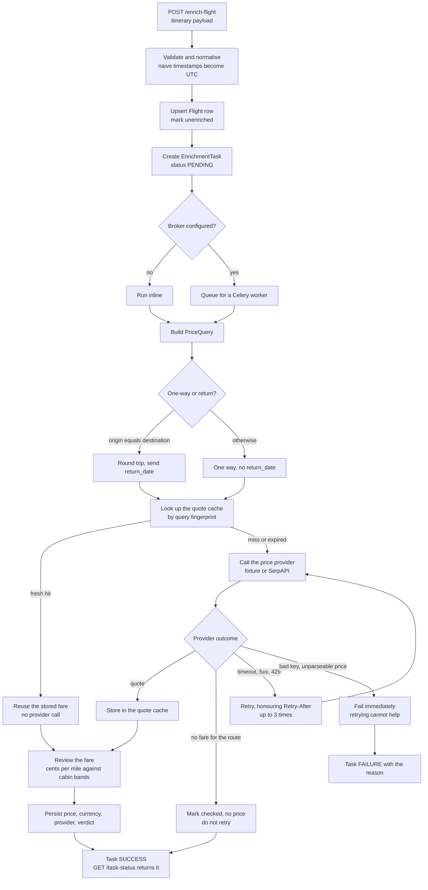
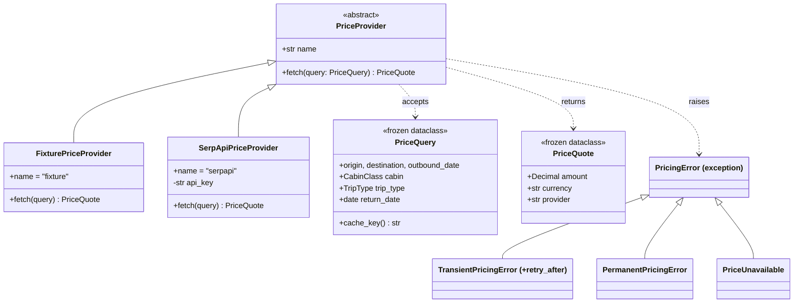
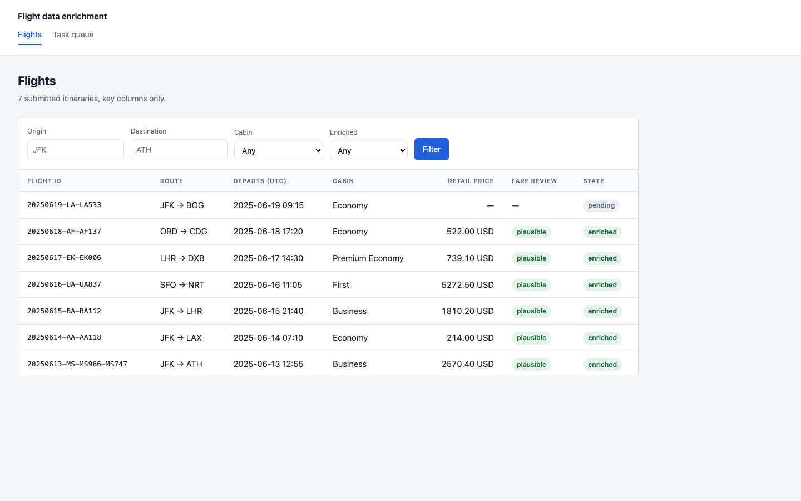
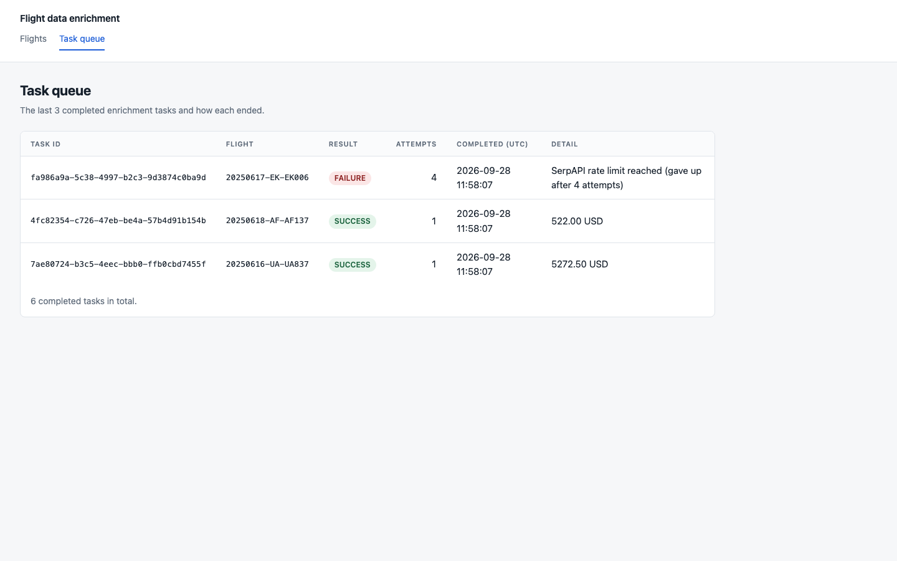

# Flight data enrichment

Submit a flight itinerary, get a task id back, poll it, and receive a retail fare for
that journey.

This started as the FlyFlat senior-Python take-home exercise — the brief is in the repo
as [`FlyFlat Backend Development Interview Exercise - Flight Data Enrichment.pdf`](./FlyFlat%20Backend%20Development%20Interview%20Exercise%20-%20Flight%20Data%20Enrichment.pdf).
It asked for a FastAPI endpoint, a Celery task queue, a SerpAPI price lookup, two Django
views, a schema and a test. That is still exactly what this is: a small, complete
exercise, not a production pricing platform.

The one thing it does that the brief did not ask for is put the price lookup behind an
interface. SerpAPI is metered and needs an account, and a project nobody can run is a
project nobody will read — so the default provider serves deterministic fares from a
checked-in JSON file, and `git clone` to a working `/enrich-flight` call is four commands
and no credentials.

## Try it

```bash
python -m venv .venv && source .venv/bin/activate
pip install -r requirements.txt
python backend/manage.py migrate
uvicorn api.main:app --port 8000
```

Then, with the sample payload from the exercise brief:

```bash
curl -s -X POST localhost:8000/enrich-flight \
  -H 'content-type: application/json' -d @sample_flight.json
```

That returns a `task_id` and, with no broker configured, a status of `SUCCESS` — the task
ran inline and has already finished. `GET /task-status/{task_id}` gives back the status,
the attempt count, the abridged flight, and this `result`:

```json
{
  "flight_id": "20250613-MS-MS986-MS747",
  "retail_price": "2570.40",
  "currency": "USD",
  "provider": "fixture",
  "cache_hit": false,
  "review": {
    "rating": "plausible",
    "rationale": "40.8 c/mi sits inside the 12-240 c/mi band for Business.",
    "reviewer": "heuristic",
    "cents_per_mile": 40.79
  },
  "warnings": []
}
```

`GET /healthz` reports which provider the process is actually wired to, which is worth
checking first whenever the numbers look wrong.

## Where the exercise requirements live

| The brief asked for | It is here |
| --- | --- |
| Endpoint accepting the flight payload | `api/routers/enrichment.py` → `POST /enrich-flight` |
| A task queue processing enrichment asynchronously | `backend/flights/tasks.py`, Celery with Redis |
| Endpoint to check a task by id | `GET /task-status/{task_id}` |
| Abridged flight info, status and price when complete | `Flight.summary()` in `backend/flights/models.py` |
| Django view: last 3 completed tasks and their result | `TaskListView`, `/flights/tasks/` |
| Django view: table of flights, key columns only | `FlightListView`, `/flights/` |
| SerpAPI price lookup | `backend/flights/providers/serpapi.py` |
| Handle upstream errors and rate limiting | the error taxonomy in `providers/base.py`, applied in `tasks.py` |
| Database schema for flights and task results | `backend/flights/models.py` |
| A test of the endpoint | `api/tests/`, plus the suite under `backend/flights/tests/` |

## How a submitted itinerary becomes a priced one



Four of those decisions are worth spelling out, because each is a way an enrichment
pipeline quietly returns a number that is *wrong* rather than a number that is missing.

**One way is not a round trip.** JFK→ATH does not come back to JFK, so it is priced as a
one-way search with no return date — sending the arrival date as a return date prices a
journey home nobody asked for, and the answer looks entirely valid. `build_query` in
`backend/flights/services/enrichment.py` decides this from whether origin and destination
match.

**The cabin has to be sent.** Google Flights defaults to economy when `travel_class` is
omitted, so a business itinerary comes back at roughly a quarter of its fare with no
error anywhere. `CabinClass.serpapi_code` maps the cabin onto the integer it expects.

**Not every failure deserves a retry.** Rate limits, timeouts and 5xx are
`TransientPricingError` and climb a three-step ladder, using the upstream's own
`Retry-After` when it sent one. A rejected key, a malformed price and a missing flight
row are `PermanentPricingError` and fail on the first attempt — they fail identically on
the fourth. "No fare for this route" is neither: it is an answer, so the flight is marked
checked with no price and never retried.

**A price without a currency is not a price.** The provider is asked to quote in USD but
the response says what it actually used, and that is what is stored next to the amount.

## Pricing without a SerpAPI key



`FixturePriceProvider` reads `backend/flights/providers/data/fares.json` — a one-way
economy base fare per route — and applies a cabin multiplier and a round-trip multiplier.
Being deterministic is what lets the tests assert that a business JFK→ATH is exactly
`2570.40` rather than merely that something numeric arrived.

`SerpApiPriceProvider` is the real thing, reached by setting `FLIGHT_PRICE_PROVIDER`
and `SERPAPI_KEY`. Adding a third source — Amadeus, Kiwi, a cached internal feed — is one class and one line
in the registry at `backend/flights/providers/__init__.py`. Nothing in the service layer,
the task, the API or the views changes.

**The quote cache.** SerpAPI charges per search, and resubmitting the same itinerary is a
normal thing for an upstream feed to do. `PriceQuoteCache` is keyed by a SHA-256 of the
normalised query — route, date, cabin, trip type, currency — so two workers pricing the
same itinerary land on the same key, and it expires after `PRICE_QUOTE_TTL_SECONDS` (six
hours) because fares move. Note what is *not* in the key: the flight id, so two different
itineraries on the same route and cabin share one lookup. Note what *is*: the cabin, so a
business search never reads back an economy answer.

## The fare review

A step that pulls one number out of a third-party response has no opinion about whether
the number makes sense. The failures above — a round-trip fare read as one way, a cabin
that silently defaulted to economy — all produce a well-formed `Decimal` that is wrong by
a multiple. The review is a cheap check in front of that, stored alongside the price
rather than replacing it.

The default is `HeuristicFareReviewer`: cents per mile against a per-cabin band table in
`backend/flights/review/heuristic.py`. The bands are wide on purpose — the job is to
catch an order-of-magnitude mistake, not to second-guess a good sale fare — and
itineraries under 250 miles are not scored, because fixed costs swamp the per-mile figure.

`FARE_REVIEWER=claude` swaps in `ClaudeFareReviewer`, which sends the itinerary shape
(leg count, cabin, distance, trip type, currency) to the Anthropic Messages API and takes
a structured verdict back through a tool schema — the part a fixed band table cannot
weigh. It degrades to the heuristic on every failure path: no `ANTHROPIC_API_KEY`,
package not installed, API error, malformed reply. A review is advisory, and losing it
must never cost you the price you already paid to fetch.

## The two pages

`/flights/` — every submitted itinerary, key columns only, filterable by route, cabin and
enrichment state, paginated at 25.



`/flights/tasks/` — the last three completed enrichment tasks and how each one ended.



Run them with `python backend/manage.py runserver` against the same SQLite file the API
writes to. The FastAPI side publishes its own OpenAPI page at `/docs`.

## The schema

Three tables, in `backend/flights/models.py`.

**`Flight`** is the itinerary as submitted plus what enrichment added: `retail_price`,
`currency`, `price_provider`, `fare_review`, `enriched_at`. `flight_id` is unique — the
id in the payload is the natural key, so resubmitting updates rather than duplicates.
Composite indexes cover what is actually queried: `(enriched, -last_seen)` for the list,
`(origin, destination)` for the route filter.

**`EnrichmentTask`** is one request against one flight, keyed by the Celery task id, with
an `attempts` counter and a JSON `result`. Its `(status, -completed_at)` index is exactly
the shape of the queue view, which reads `EnrichmentTask.objects.completed().with_flight()`
— that join is not decoration, since the template renders `task.flight.flight_id` on
every row.

**`PriceQuoteCache`** is the fares already fetched, keyed by the query fingerprint.

Status and cabin are `TextChoices` in `backend/flights/enums.py`, so `'PENDING'` is not
typed into six different files.

## Configuration

Environment-driven, every value defaulted to something that works. Copy `.env.example` to
`.env` to change any of them.

| Variable | Default | What it does |
| --- | --- | --- |
| `FLIGHT_PRICE_PROVIDER` | `fixture` | `fixture` or `serpapi` |
| `SERPAPI_KEY` | empty | required only for `serpapi` |
| `PRICE_QUOTE_TTL_SECONDS` | `21600` | how long a fetched quote stays reusable |
| `FARE_REVIEWER` | `heuristic` | `heuristic` or `claude` |
| `ANTHROPIC_API_KEY` | empty | required only for `claude` |
| `CELERY_BROKER_URL` | empty | unset means tasks run inline, no broker needed |
| `SECRET_KEY` | a visibly-fake dev key | Django secret |
| `DEBUG` / `ALLOWED_HOSTS` | `1` / localhost | Django |
| `DATABASE_PATH` | `backend/db.sqlite3` | SQLite file location |

Inline execution is the zero-dependency default, not the intended production shape. Point
`CELERY_BROKER_URL` at Redis and run `cd backend && celery -A backend worker` to move
pricing onto a real queue, at which point `POST /enrich-flight` returns `PENDING` and the
worker does the pricing.

## Tests

```bash
pip install -r requirements-dev.txt
pytest          # 117 tests
ruff check . && ruff format --check .
```

No broker, no network, no keys: `backend/backend/test_settings.py` pins the suite to the
fixture provider, the heuristic reviewer and inline execution regardless of what is in
your `.env`. The SerpAPI adapter is covered against an `httpx.MockTransport` rather than
the live endpoint, including the partial-response cases (`best_flights` present but
empty; entries present with no `price` key), the 429 path with and without a
`Retry-After` header, and the difference between a 503 and a 400.

## Docker

```bash
docker compose up --build
```

Four services: the FastAPI app on 8000, a Celery worker, the Django site on 8001, and
Redis. All three Python services share one SQLite file on a named volume — the honest
limitation of keeping SQLite, and the reason this compose file is a demonstration rather
than a deployment. The image is multi-stage and runs as a non-root user.

`docker compose config` parses. The image has not been built or booted here — Docker was
unavailable on the machine this was last worked on.

## What I would fix before this saw real traffic

- **SQLite.** Concurrent writes from the API process and a worker pool will contend.
  Nothing in the models is SQLite-specific, so it is a `DATABASES` change and a migration
  run — but it has not been done.
- **No authentication.** Anyone who can reach the port can submit itineraries and read
  every stored fare. The exercise did not ask for auth, and I would rather say so than
  add a token scheme I then have to defend.
- **Distance comes from the payload.** When per-leg `distance` is absent the review is
  skipped with a warning rather than computed from airport coordinates.
- **No negative caching.** A route with no fare is re-asked on every submission, which on
  a metered provider is a real cost for a known-empty answer.
- **The fixture fares are invented** — plausible multipliers over plausible base fares,
  chosen so the pipeline is demonstrable and the tests can assert exact numbers. They are
  not market data.

